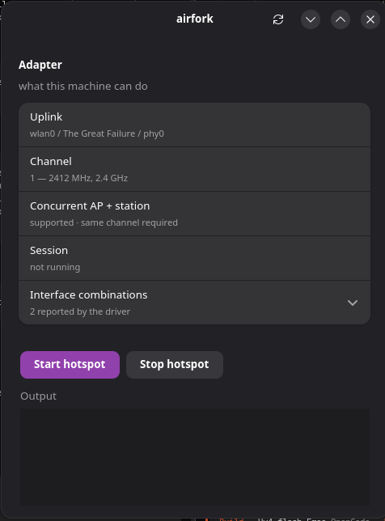

# airfork

Experimental Linux tool that shares a Wi-Fi uplink over a second, virtual Wi-Fi
access point on the **same physical card**. The laptop stays connected to its
network while other devices join the hotspot and browse through it.

Built by Meshack Bahati. Free software under the MIT licence, see `LICENSE`.



## the problem it solves

On Windows, Mobile Hotspot is a single toggle. Behind the scenes Windows
creates a virtual Wi-Fi adapter, pins it to a usable channel, and hides the
DHCP and NAT setup.

Linux has no equivalent one-command switch. The obvious command,
`nmcli dev wifi hotspot`, turns the physical card into an access point and
**drops the existing Wi-Fi connection**. Most guides therefore tell you to buy
a second USB Wi-Fi dongle.

On Intel cards such as the 9260 and AX200, the driver already supports one
station interface and one AP interface at the same time. What is missing is
the glue. airfork provides that glue:

- reads `iw phy ... info` to confirm that `managed` and `AP` can coexist;
- stops NetworkManager from grabbing the virtual interface before hostapd
  can use it;
- works around the regulatory block that marks 5 GHz channels as passive-scan
  on these adapters by limiting the uplink to 2.4 GHz, where an AP may transmit;
- tells wpa_supplicant to ignore the router's 802.11v "move to another band"
  requests for the duration of the session, which otherwise causes the uplink
  to drop every few minutes;
- runs hostapd and dnsmasq, adds a marked NAT rule, and tears all of it down
  again on `stop`.

## requirements

`iw`, `ip`, `hostapd`, `dnsmasq`, `iptables`, NetworkManager and a C compiler
toolchain for the GTK crates. The GUI needs a GTK4 / libadwaita session.

## build and install

```sh
cargo build --release
./install.sh
```

`install.sh` puts the CLI in `/usr/local/bin`, the GUI in `~/.local/bin`, adds
a desktop launcher, and installs a polkit action so the privileged buttons
ask once per session instead of on every click.

## use

```sh
airfork detect                     # read only, works as a normal user
airfork plan                       # what start would do
sudo airfork start --ssid LabHotspot --password airfork-2026
airfork status
sudo airfork stop
```

The GUI exposes the same operations. Press **Start hotspot**, then **Stop
hotspot** when finished. The default credentials are `LabHotspot` and
`airfork-2026`; change them in the window before starting. `start` needs root
through `sudo` or `pkexec`. All changes are reverted by `stop`.

## the catch

- One radio means one channel. `iwlwifi` reports `#channels <= 1` for AP plus
  station, so the hotspot follows the uplink channel rather than choosing its
  own. Since 5 GHz is passive-scan here, the uplink is moved to 2.4 GHz for the
  duration of the session. That is a short reconnect at start, not a dropped
  connection.
- Throughput is shared between the uplink and the clients.
- The connection profile is limited to band `bg` while running and restored
  on stop. The station stays on 2.4 GHz until it reconnects by itself.
- 802.11v BTM handling is disabled while running so the router cannot steer
  the station back to 5 GHz mid-session. It is restored on stop.
- This is a lab tool for sharing your own connection, not a jamming tool.

## layout

```
src/lib.rs   capability detection, start, stop, status and rollback
src/cli.rs   command-line frontend
src/gui.rs   GTK / libadwaita frontend
```

Licensed under the MIT License. Copyright (c) 2026 Meshack Bahati.
